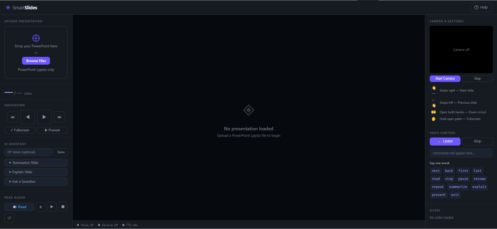

# 🎯 SmartSlides

**A gesture- and voice-controlled presentation viewer that runs entirely in your browser.**

SmartSlides lets you navigate PDF presentations and images using hand gestures, voice commands, keyboard shortcuts, and touch controls. Optional AI features can summarize slides, explain concepts, and answer questions.

**Repository:** https://github.com/abdur-rehman-khan/SmartSlides
## 📸 Application Screenshot


## ✨ Features

| Feature | Description |
|---|---|
| PDF and image upload | PDF.js renders PDF pages; images load natively |
| Hand gesture control | MediaPipe Tasks Vision tracks your hand using your webcam |
| Voice commands | Web Speech API enables voice-controlled navigation |
| Read aloud | SpeechSynthesis reads slide text aloud |
| AI assistant | Summarize, explain, and ask questions using the Hugging Face Inference API |
| Slide thumbnails | Navigate quickly using generated slide previews |
| Fullscreen mode | Present slides in native browser fullscreen |
| Touch controls | Swipe between slides on mobile devices |
| Keyboard shortcuts | Navigate using arrow keys, Page Up/Down, Home, and End |

## 🖐️ Hand Gesture Guide

| Hand movement | Action |
|---|---|
| Move your open hand to the right | Previous slide |
| Move your open hand to the left | Next slide |

The webcam preview is mirrored, so move your hand in the direction you see it move on screen.

## 🎙️ Voice Commands

| Say | Action |
|---|---|
| `next slide` | Go to the next slide |
| `previous slide` | Go to the previous slide |
| `first slide` | Jump to the first slide |
| `last slide` | Jump to the last slide |
| `read this slide` | Read the slide text aloud |
| `stop reading` | Stop text-to-speech |
| `pause` | Pause reading |
| `resume` | Resume reading |
| `summarize slide` | Generate an AI summary |
| `explain slide` | Request an AI explanation |
| `start presentation` | Enter fullscreen mode |
| `stop presentation` | Exit fullscreen mode |

## 🚀 Getting Started

### Option 1: Download the project

1. Open the [SmartSlides GitHub repository](https://github.com/abdur-rehman-khan/SmartSlides).
2. Click **Code → Download ZIP**.
3. Extract the downloaded ZIP file.
4. Open `index.html` in a modern browser.

For the best experience, use a local development server, especially if browser security restrictions prevent camera or microphone access.

### Option 2: Clone with Git

Install [Git](https://git-scm.com/downloads), then run:

```bash
git clone https://github.com/abdur-rehman-khan/SmartSlides.git
cd SmartSlides
```

Open the project in VS Code or your preferred editor.

To run a local server using Python, execute:

```bash
python -m http.server 8000
```

Then open http://localhost:8000 in your browser.

## 🤖 AI Assistant Setup

The optional AI features use the Hugging Face Inference API and the `mistralai/Mistral-7B-Instruct-v0.3` model.

1. Create or sign in to your [Hugging Face account](https://huggingface.co/).
2. Create an access token at [Hugging Face token settings](https://huggingface.co/settings/tokens).
3. Open SmartSlides and enter your token in the AI Assistant panel.
4. Click **Save** to enable the AI features.

The token is stored in browser `sessionStorage`, which is cleared when the browser tab's session ends. It is not intended to be embedded in the source code.

**Important security note:** Browser-side tokens can be accessed by JavaScript running on the same page. Only use a token with the minimum permissions required, and never commit it to GitHub. For a production deployment with shared API access, use a secure backend or server-side proxy.

AI features require PDFs with selectable text. Scanned PDFs may need OCR before their contents can be analyzed.

## 📁 Project Structure

```text
SmartSlides/
├── index.html    # Main application
├── style.css     # Application styles
├── script.js     # Application logic
└── README.md     # Project documentation
```

## 🌐 Deployment

SmartSlides is a static web application and does not require a traditional backend for its core presentation features.

You can deploy it using a static hosting provider, such as:

- [GitHub Pages](https://pages.github.com/)
- [Cloudflare Pages](https://pages.cloudflare.com/)
- [Netlify](https://www.netlify.com/)
- [Vercel](https://vercel.com/)

### Deploy with GitHub Pages

1. Open the [SmartSlides repository](https://github.com/abdur-rehman-khan/SmartSlides).
2. Navigate to **Settings → Pages**.
3. Under the build and deployment section, select **Deploy from a branch**.
4. Choose the `main` branch and the root (`/`) folder.
5. Save the settings and wait for deployment.

If deployment succeeds, your site will generally be available at:

`https://abdur-rehman-khan.github.io/SmartSlides/`

This URL assumes GitHub Pages is enabled and your repository contains the required files in the selected location.

**Note:** GitHub Pages is static hosting. It cannot securely store private API keys or run a server-side proxy. Users must provide their own AI token unless you implement a separate backend.

## ⌨️ Keyboard Shortcuts

| Key | Action |
|---|---|
| `→` / `↓` / `Page Down` | Next slide |
| `←` / `↑` / `Page Up` | Previous slide |
| `Home` | First slide |
| `End` | Last slide |
| `F5` | Start presentation |
| `Esc` | Exit fullscreen |

## 🌍 Browser Compatibility

| Feature | Chrome | Edge | Firefox | Safari |
|---|---|---|---|---|
| Voice recognition | Supported | Supported | Limited or unavailable | Limited or unavailable |
| Text-to-speech | Supported | Supported | Supported | Supported |
| Hand gestures | Depends on camera and WebGL/WASM support | Depends on camera and WebGL/WASM support | Depends on camera and WebGL/WASM support | Depends on camera and WebGL/WASM support |
| PDF and image viewing | Supported | Supported | Supported | Supported |

**Recommended:** Google Chrome or Microsoft Edge for the best overall voice-control experience.

## 🔒 Privacy

- **Webcam:** Video is processed locally by MediaPipe when gesture detection is active.
- **Voice:** Speech recognition may use browser-vendor servers, depending on the browser implementation.
- **AI token:** Stored in browser session storage by the application.
- **Slide content:** Remains in the browser unless you use features that send extracted text to the AI service.

Avoid uploading confidential presentations when using external AI services.

## ⚠️ Limitations

- Voice recognition support varies by browser.
- AI analysis requires extractable text from PDFs.
- Hand gesture detection works best with good lighting and a clear background.
- MediaPipe model assets must download before gesture detection can start.
- Hugging Face Inference API availability and rate limits depend on the model and account.

## 📄 License

This project is licensed under the MIT License. See the `LICENSE` file if one is included in the repository.

---

Developed by [Abdur Rehman Khan](https://github.com/abdur-rehman-khan).

If you find this project useful, consider giving the repository a ⭐ on GitHub.
